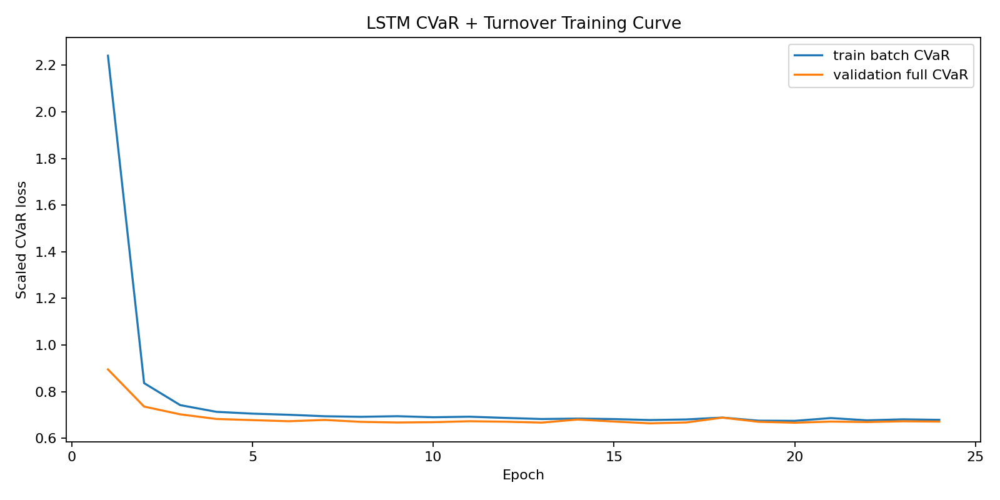
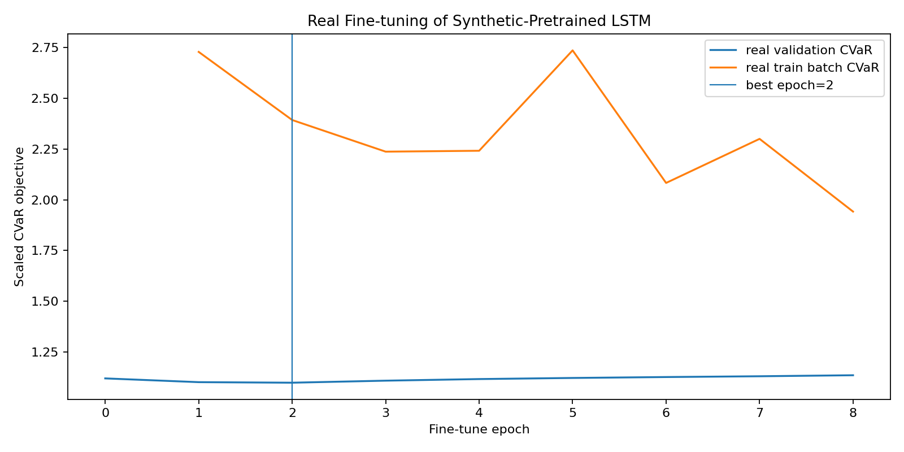
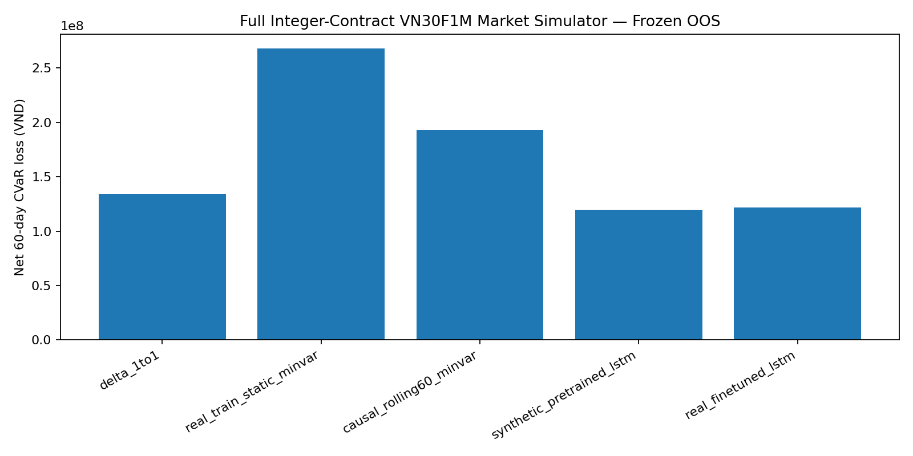
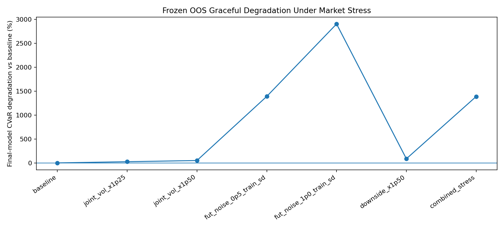
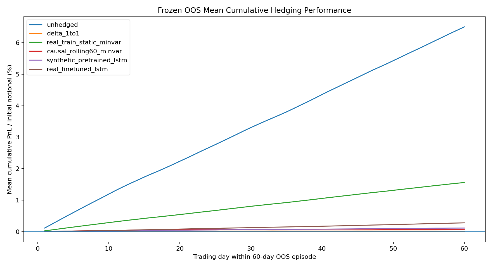
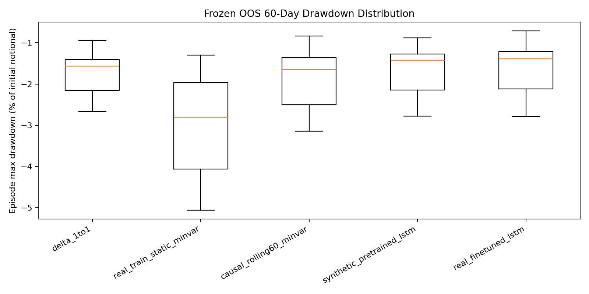

# DeepHedging-VN30 — Báo cáo phương pháp và bàn giao nghiên cứu

Ngày đóng gói mã nguồn và tài liệu: 11/10/2026. Đã đối chiếu các artifacts (tệp kết quả), lịch sử huấn luyện và bảng đánh giá do người thực hiện cung cấp ngày 11/10/2026. Đây là rà soát bằng chứng và tính nhất quán; chưa huấn luyện lại độc lập trong môi trường sạch.

## 1. Mục tiêu và câu hỏi nghiên cứu

Nghiên cứu học một hedging policy (chính sách phòng hộ) để giảm rủi ro danh mục có exposure (quy mô chịu rủi ro) tương đương VN30 bằng vị thế short VN30F1M, dưới chi phí giao dịch. Đây là ứng dụng nguyên tắc Deep Hedging (phòng hộ bằng học sâu) cho danh mục cơ sở, không tái lập nguyên bài toán nghĩa vụ payoff (khoản chi trả) quyền chọn của Buehler et al. [1].

Câu hỏi: LSTM có giảm net CVaR (CVaR ròng sau chi phí) so với hedge 1:1 và minimum variance không? Synthetic pretraining (huấn luyện trước trên dữ liệu nhân tạo) chuyển sang dữ liệu thực ra sao? Lợi ích có bền vững theo regime (trạng thái thị trường), phí và cú sốc không?

## 2. Dữ liệu và thiết kế thời gian

Dữ liệu ngày VN30 và continuous front-month VN30F1M từ 10/08/2017 đến 29/09/2026. Methodology ghi 2.279 và 2.281 dòng, 2.279 ngày chung; hai ngày futures-only 23–24/01/2018 không được tạo giá spot giả. Các số lượng phải đối chiếu output bước 01.

TRAIN: 2017–2022 (1.350 dòng); VALIDATION: 2023–2024 (499); TEST: 2025–29/09/2026 (430), theo tài liệu phương pháp. TRAIN phục vụ ước lượng/học; VALIDATION chọn cấu hình/checkpoint; TEST đánh giá sau freeze (đóng băng). Dữ liệu là chỉ số đại diện; chưa có danh mục cổ phiếu thực với dividend, tracking error và phí quản lý.

## 3. Tiền xử lý và biến đặc trưng

Pipeline alignment, log-return, 28 engineered features, kiểm định thống kê và chẩn đoán outlier/roll. Biến thuộc các nhóm return, momentum, realized/Garman–Klass volatility [9], range, volume, basis, correlation và rolling min-var. Lookback tối đa 60 phiên. Causal timing (thời điểm nhân quả): dữ liệu tại close t được dùng cho action áp dụng t→t+1; chưa mô phỏng độ trễ thực thi close.

Policy dùng 7 biến riêng: return spot/futures vừa kết thúc, basis hiện tại, volatility, log spot/futures tương đối so với đầu episode và thời gian còn lại. Không đưa toàn bộ 28 features vào mạng; chưa có feature ablation chứng minh bộ 7 tối ưu. Previous position không được cung cấp trực tiếp.

## 4. Synthetic market

Heston [6] mô phỏng spot và variance bằng full-truncation Euler; basis AR(1) sinh futures theo F=S(1+b). Physical-measure estimation (ước lượng dưới độ đo thực) lấy từ TRAIN; refinement từ VALIDATION; không phải option-surface risk-neutral calibration. Thiết kế frozen generator: 20.000 TRAIN, 4.000 VALIDATION, 4.000 synthetic TEST, 60 khoảng giao dịch/path. Tham số/version thực dùng phải lấy từ frozen metadata.

Số path lớn giảm Monte Carlo error trong mô hình đã chọn, không loại bỏ model risk. Standard Heston có mismatch volatility clustering, heavy tails và rho ở boundary được ghi trong methodology. Synthetic volatility là latent sqrt variance; real volatility là GK proxy, tạo semantic domain mismatch.

## 5. Baselines và policy

Baselines: unhedged; hedge 1:1; static min-var ước lượng TRAIN; causal rolling-60 min-var. h*=Cov(rS,rF)/Var(rF), liên hệ futures hedging [11–14]. Hedge 1:1 là exposure hedge chỉ số, không phải derivative delta từ option-pricing model.

LSTM một lớp hidden=128 [3], linear head và 1.5×sigmoid giới hạn h trong [0,1.5]. Bước 17 tối thiểu variance sanity baseline; bước 18 tối ưu worst-5%-loss CVaR [5] của terminal normalized log-PnL sau turnover penalty lambda=0.001. Turnover gồm mở, điều chỉnh và đóng; penalty không phải đầy đủ phí VND. Bước 22 fine-tune TRAIN, chọn VALIDATION, có thể giữ epoch 0 nếu không cải thiện. Early stopping không chứng minh optimum toàn cục hoặc hội tụ đầy đủ.

## 6. Simulator kinh tế

Exposure đầu kỳ 10 tỷ VND; multiplier 100.000 VND/điểm; N=round-half-up(hV/(FM)). Futures PnL=-N×M×(F_next-F_now). Portfolio units giữ cố định trong episode. Có fees, broker commission 3.000 VND/contract/match, project PIT formula, slippage 1 tick và roll-cost calendar proxy.

Margin 50% là giả định dự án; 10 tỷ là spot exposure, không phải ngân sách tổng spot+margin. Chưa có intraday margin call, funding opportunity cost đầy đủ, hard cash constraint, order-book impact và historical contract-chain roll spread. Config hiện có là cơ sở của kết quả cũ, không đại diện cam kết biểu phí hiện hành cho giao dịch live.

## 7. Đánh giá và cách diễn giải

Đánh giá PnL, CVaR loss tail 5%, chi phí, turnover, hedge ratio, margin; baseline reporting bổ sung descriptive Sharpe và drawdown. Relative risk reduction=1-CVaR_model/CVaR_baseline chỉ dễ diễn giải khi mẫu số dương và không gần 0. Kết quả tuyệt đối giữa payoff phái sinh gốc và danh mục VN30 không so trực tiếp.

370 overlapping 60-day episodes là mô tả, không phải 370 mẫu độc lập. Chưa có confidence interval xử lý phụ thuộc hay kết quả multiple seeds, nên không tuyên bố statistical superiority/probability of outperformance. Bước 28 tạo mean within-episode cumulative curve, không phải wealth curve liên tục với quy tắc triển khai đã xác định.

Regime dùng TRAIN terciles của trailing return, sideways là nhóm giữa theo định nghĩa đó. Cost ablation thay đổi phí và slippage 0.5–4 tick; đó là liquidity proxy stress, chưa empirical order-book liquidity analysis. Graceful degradation là open-loop: action từ state gốc giữ nguyên khi forward returns bị shock; không đánh giá policy thích ứng theo stressed states.

## 8. Kết quả hiện có và điều kiện kết luận

### Huấn luyện và chọn checkpoint

LSTM variance chạy 17 epochs, chọn epoch 11; LSTM CVaR chạy 24 epochs, chọn epoch 16 với validation CVaR scaled = 0.664164685. Fine-tuning (tinh chỉnh) chạy 8 epochs sau epoch 0, chọn epoch 2: validation CVaR scaled giảm từ 1.119922819 xuống 1.098733029, tương đương 1.892%. Giá trị scaled dùng trong lịch sử không phải số tiền VND. Các minimum được đối chiếu với CSV; đây là cải thiện validation và early stopping (dừng sớm), không chứng minh hội tụ toàn cục.

Thời gian do reports ghi nhận trên CPU: variance 87.75 giây, CVaR 76.59 giây, fine-tuning 1.78 giây. Đây là thời gian vòng huấn luyện ghi trong từng report, không phải thời gian toàn pipeline. Quy mô này không cần A100; chưa phải thí nghiệm lớn tương đương mọi cấu hình trong bài báo gốc.

### OOS và simulator có chi phí

Bảng sau lấy từ `results/tables/full_market_simulator_frozen_summary.csv`: exposure 10 tỷ VND, 370 episodes chồng lấn, hợp đồng nguyên, phí/thuế/slippage theo config dự án. CVaR là trung bình tổn thất đuôi xấu nhất 5%; thấp hơn biểu thị giảm tail risk (rủi ro đuôi).

| Chiến lược | Net CVaR 5% (triệu VND) | PnL ròng trung bình (triệu VND) | Chi phí trung bình (triệu VND) |
|---|---:|---:|---:|
| unhedged | 967.611 | 649.975 | 0.000 |
| delta_1to1 | 134.277 | -30.296 | 30.640 |
| real_train_static_minvar | 267.835 | 132.126 | 23.313 |
| causal_rolling60_minvar | 192.937 | -23.455 | 28.902 |
| synthetic_pretrained_lstm | 119.439 | -20.427 | 30.652 |
| real_finetuned_lstm | 121.903 | -3.018 | 30.133 |

Final fine-tuned LSTM giảm net CVaR **9.216%** so với delta 1:1, **54.486%** so với static min-var và **36.817%** so với rolling min-var. Trong normalized turnover-cost evaluation (đánh giá với chi phí turnover chuẩn hóa), mức giảm so với delta là **3.816%**; không trộn chỉ tiêu này với simulator VND.

Pretrained LSTM có net CVaR 119.439 triệu, thấp hơn final 121.903 triệu. Fine-tuning cải thiện VALIDATION nhưng không cải thiện mọi chỉ tiêu TEST; giữ checkpoint đã chọn trước TEST. PnL ròng trung bình final là **âm 3.018 triệu/episode**: mục tiêu chính là giảm rủi ro, chưa có bằng chứng tạo lợi nhuận ròng dương. Margin lớn nhất final khoảng **6.288 tỷ VND**, bổ sung vào nhu cầu vốn ngoài spot exposure.

### Regime, chi phí và stress

Regime có 37 bear, 175 sideways, 158 bull episodes. Bảng regime là gross PnL theo đơn vị riêng của bước 25, không lấy trực tiếp so với net VND của simulator 10 tỷ. Cost ablation đã có bảng kết quả; slippage stress chỉ là proxy (biến đại diện) thanh khoản.

Downside x1.5 có final CVaR 0.016792640 so với delta khoảng 0.011946; final **tệ hơn delta 40.563%**. Futures noise 0.5 và 1.0 TRAIN standard deviation làm CVaR tăng khoảng 13.90 và 29.04 lần phần tăng tương đối so với baseline. Kết quả không hỗ trợ tuyên bố robust (bền vững) trong mọi trạng thái. Stress giữ nguyên actions từ đường gốc, không phải closed-loop policy response (phản ứng chính sách vòng kín).

Các biểu đồ cumulative/drawdown là mô tả trong episode chồng lấn; chưa phải tài sản tích lũy của giao dịch liên tục. Kết luận được hỗ trợ: mô hình giảm CVaR trên mẫu OOS và cấu hình đánh giá này so với các baseline truyền thống; chưa xác nhận ý nghĩa thống kê, hiệu quả live hoặc ưu thế trên mọi stress.

## 9. Integrity và giới hạn nghiên cứu

TEST đã được mở; trước split policy có exploratory aggregate contamination caveat. Không gọi TEST pristine. Mọi nâng cấp model/features sau khi xem TEST là nghiên cứu mở rộng; cần protocol riêng và holdout chưa dùng cho lựa chọn để kết luận confirmatory. Không retune trên TEST cũ để hoàn thành checklist.

Thiếu multiple seeds, feature/architecture ablation và uncertainty analysis là giới hạn còn lại; GRU không được tuyên bố hoàn thành. Không cần GPU A100 để hợp thức hóa nhãn học sâu; compute scale phải xuất phát từ thiết kế thí nghiệm.

## 10. Ứng dụng và bàn giao

Ứng dụng trước mắt là research decision support/paper trading cho danh mục gần VN30, không phải auto-trading live. Xem `PRACTICAL_APPLICATION.md` cho quy trình vị thế, margin, roll và kiểm soát rủi ro. Xem `REPRODUCIBILITY.md` cho thứ tự pipeline; `ANTIGRAVITY_ACCEPTANCE.md` cho kiểm chứng; `project.py package` cho ZIP và SHA-256 manifest.

## 11. Tài liệu tham khảo

Số [1], [3], [5], [6], [9], [11–14] theo `../literature/REFERENCES.md`, danh mục 22 nguồn. Học thuật nền tảng và nguồn thị trường phải được đối chiếu với claim cụ thể. Chưa xác nhận mọi URL/DOI trong lần đóng gói này.
